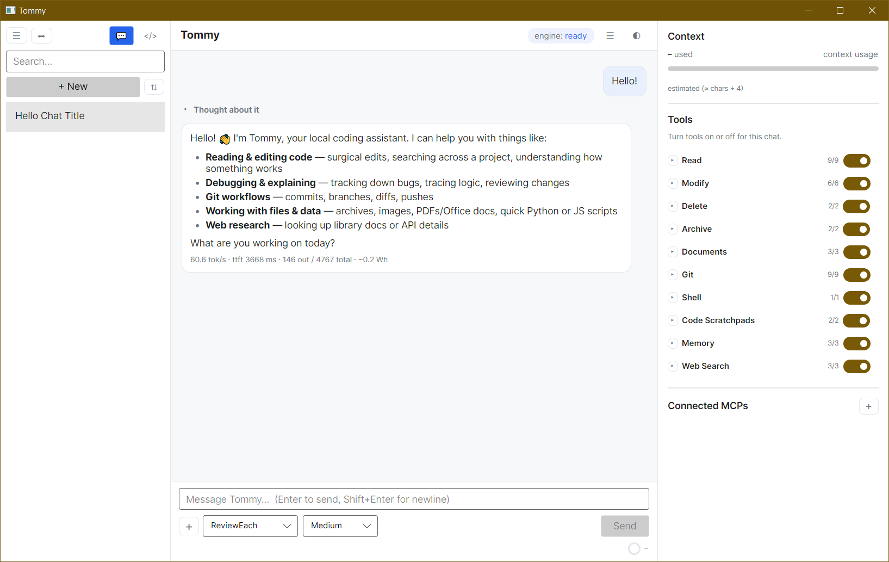

Tommy 
---------

Tommy is a desktop coding agent that use the excellent Strata LLM engine.

# Backstory

After trying many local agents, I decided none of them matched my expectations and requirments, thus I decide to develop Tommy. 

I tried many local agents, and I found limitation in each one of them:

- LM Studio Bionic was a gold mine when I found it, but it runs very slowly on my PC. The same PC can run Strata engine with a bigger model at 100t/s, whereas Bionic running a smaller model can do 10-15t/s. Bionic limitation was that it did not support custom OpenAI comptabile endpoints, and it seems they are pushing for the cloud api more than running local models.
- Goose: Goose user interface is a huge mess. You cannot change permission level once a chat is created, and all chats should have a working directory. You cannot even delete a chat! You have go to settings and find chat history to be able to delete. Goose also did not allow chaging a chat reasoning effort, instead it has to be done in settings and it will apply for new chats only.
- AnythingLLM: Not an agent, but at first I liked the idea that it can take any kind of file and feed it to a model. However it cannot take directories, so I dropped it.
- Cline worked the best out of the 3 I tried, but cline has to live inside an IDE (not an issue), and the integration in Visual Studio code was clunky. It also provided poor tool support for the model, since it kept using the shell for most basic tasks (find files, read file, get file line count, etc). 

I drafted the project plan and started the initial development with Claude Code, but once Tommy is mature enough, I will use it to develop itself. I believe coding agents should not replace human efforts, and instead they should complement it.

A little trivia about the name: Claude is the main character name in GTA 3, and Tommy is the name of GTA Vice City main character.

# Project Goal

Project goals are the following:

- Provide a good subset of built-in tools with focus on sandboxing and LLM security best practices.
- Provide a good user experience, including interaction with the app and an organized user interface.
- Provide good extensiblity via Skills and MCP servers.

Tommy does not intend to replace Claude Code, as limitations of local models are real (context length and speed).
However for most tasks, Tommy can be used and it's smart enough to manage its context window well.

# LLM Model and Speed

Since Tommy relies on Strata engine, the speed depends on your Strata engine. But the strata engine is well optimized and people feedback shows that.

The model that Tommy use is Qwen3.8-Flash-Next

On my machine, it runs about 60-100t/s, depending on context length. Your mileage may varies.

Currently I am focused on using the Strata engine, it's well integrated in Tommy and I even use custom Strata APIs for metrics.

However, technically it is possible to use any OpenAI comptabile endpoint, as long as tool usage in that endpoint is good. I plan to add that in a future release, along with a model performance benchmark so that you can know if that endpoint is well supported or if it will gives you trouble.

# Implemented Feature Set

- Basic file and directory manipulation tools
- Git tools 
- Document (PDF, Office, Archive) tools
- Memory system
- Skill system 
- Code scratchpads (Python + JavaScript)
- Shell tools
- Web search and web research.
- Light and Dark theme.

Many more to come.

# Technology Stack

The project aims to be compatible with Windows and Linux. I used C# as it's my favorite language.
As for the UI, most of C# ecosystem is tied to a Windows UI framework (WPF, WinForms, UWP). So I decided to use Avalonia UI framework as I am familiar with XAML and it is cross platform.

The other idea for UI is to have the C# engine runs the agent core, and the UI to be an electron app using AngularJS as frontend. I may or may not follow this path, depending on how rigid avalonia customization is. For now, the UI works, and it's fast, and there is no electron bloat.

# Feedback

I am open for feedback and testing.

# Acknowledgments

Credits goes to the Strata developer Niko1221, for providing this amazing engine.

https://github.com/Niko1221/Strata
