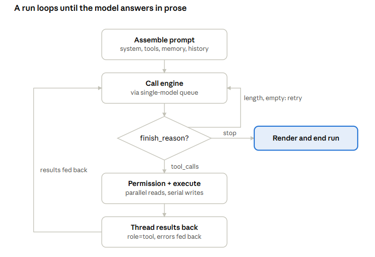

# Tommy — Living Spec

> **This is the current, authoritative design document.** It describes what Tommy
> *is and how it is built today*. The original design brief is frozen at
> [`initial-spec-v0.md`](initial-spec-v0.md) for reference only — where the two
> disagree, this file wins. Build history and phase status live in
> [`progress.md`](progress.md); engineering conventions in
> [`conventions.md`](conventions.md).

Last reviewed: 2026-10-24.

---

## What Tommy is

**Tommy** is a Windows-first (Linux-capable) desktop AI agent that orchestrates a
local **Strata** LLM over an OpenAI-compatible endpoint. The thesis: give a
locally-hosted model first-class **typed tools** on the native function-calling
path so it never has to hammer the shell — the failure mode that made tools like
Cline fall back to botched PowerShell. The harness is tuned for a single local
model: single-model request serialization, native `tool_calls`, and
reasoning-aware token budgeting.

## Stack

- **.NET 9** (SDK 9.0.304), C#.
- **Avalonia 11.3.0** — MVVM, compiled bindings (`x:CompileBindings`, binding
  errors become compile errors), Fluent theme, CommunityToolkit.Mvvm source
  generators (`[ObservableProperty]`/`[RelayCommand]`), Avalonia NameGenerator.
  The main window uses a **custom title bar** (`ExtendClientAreaToDecorationsHint`
  + NoChrome) with our own minimize/maximize/close controls and the toolbar
  consolidated into it; a thin `WindowBorder` keeps the borderless window visible.
- **Font Awesome 5 Free Solid** (`Assets/Fonts/fa-solid-900.ttf`, SIL OFL 1.1),
  bundled as the `IconFont` resource for toolbar / title-bar icon glyphs.
- **AvaloniaEdit + TextMate** (`TextMateSharp.Grammars`) for syntax-highlighted
  code blocks, shared between chat code fences and the file pane.
- **Markdig** for the block-based chat renderer.
- **System.Text.Json** with source generators for the OpenAI-compatible payloads.
- **Microsoft.Playwright (.NET) 1.60.0** (pinned to bundled `chromium-1223`) — one
  Playwright stack backs both one-shot `web_fetch_js` and the interactive browser.
- **ModelContextProtocol.Core 2.2.0** — MCP client (stdio + HTTP).
- Everything heavy runs **out of process** (engine over HTTP, scratchpads and MCP
  over stdio/HTTP, LibreOffice/Python/Node as subprocesses), so the runtime only
  orchestrates and cross-platform risk stays low. Native-dependency tools (OCR,
  decoders) sit behind interfaces that **degrade gracefully** (tool disabled with
  a clear message) rather than crashing the app.

## Solution layout

Six projects under `E:\Projects\Tommy` (branch `main`, **no remote**). Dependencies
point inward to Core; Core has no I/O and no UI, so it runs headless.

| Project | Role |
| --- | --- |
| `src/Tommy.Core` | Domain, no I/O: the tool model (`ITool`/`PermissionTier`/`PermissionGrid`/`ToolRegistry`/`ToolContext`), agent types (`TaskState`), chat/params/records, polymorphic JSONL events, skills, memory, security (`ISecretStore`), config, `Runtime/` (`TommyHome`, `IntegratedTools`), `Research/` abstractions (`TaggedData`, `WebCapabilities`), `Export/`. |
| `src/Tommy.Engine` | `StrataClient` (OpenAI + `/metrics`), `SingleModelQueue`, `EngineService`, `ManagedEngineProcess`, `Agent/` (`AgentLoop`, run, events, `ResumeHistoryBuilder`, `ContextSummarizer`), `Research/` (`HttpWebFetcher`, `LlmSummarizer`, `WebResearchOrchestrator`, `PlaywrightBrowser`, `Research/Browser/`, `Research/Searxng/`), `Provisioning/` (runtime tool downloader). |
| `src/Tommy.Tools` | Native typed tools: file read/range/count/list/find/search(+`search_all`)/edit/create/rename/delete, `git_*`, archives, conversion (`office_extract`/`pdf_extract`/`ocr`), media (`video_info`), scratchpads (`python_run`/`js_run`/`shell`), `update_task_state`, `ask_question`, `present_file`, skills, memory. `Internal/` (`Sandbox`, `GitRunner`, path sandbox). |
| `src/Tommy.Mcp` | MCP client (`McpManager`/`McpConnection`/`McpToolProxy`/`McpToolMapping`) + integrations (MySQL). |
| `src/Tommy.Persistence` | `TommyPaths`, `ConfigStore`, `PlaintextSecretStore`, first-run validation, `Storage/` (Blob/Event stores, Chat/Project/Workspace repos, `ChatSearch`, `SkillRepository`, `StarterSkills`, `MemoryStore`, `ConventionLoader`). |
| `src/Tommy.App` | Avalonia: `ShellViewModel`, `ChatViewModel`, Settings/FilePane/BrowserPane VMs, `Views/` (`MainWindow`, `FirstRunWindow`, `SettingsWindow`, …), `Controls/` (`CodeView`, `BrowserView`, `RingProgress`), `Rendering/` (Markdig block renderer, stream throttle), `Behaviors/`. |

Plus `src/scripts` (the provisioning kit — manifest + helper scripts shipped
beside the app, **not** a project), `tests/Tommy.Tests` (xUnit, 264 facts +
10 theories = **~274**), `tests/Tommy.Snapshots` (4 headless `[AvaloniaFact]`
renders — see [`claude-visual-verification.md`](claude-visual-verification.md)),
and `tools/Tommy.SmokeTest` (live engine + agent-loop console check).

## The agent loop

One run = one user message driving a sequence of engine calls until the model
answers in prose (`AgentLoop` in `src/Tommy.Engine/Agent`). The loop runs on a
background worker; the UI only observes its events (token stream, reasoning
stream, tool-call proposed, approval-needed, result, done).

1. **Assemble the prompt** — base system prompt (+ resolved thinking effort +
   injected current date/time + the `# Current task` task-state section), memory
   index, enabled tool schemas (native `tools` array), skill descriptions, upward
   convention-file cascade, pinned context, prose history.
2. **Call the engine** through the `SingleModelQueue` (busy/warming surfaced in UI).
   **Streaming is the default path** (`OnToken` sink); non-streaming only for
   fakes/sub-agents via the default-interface method.
3. **Split the response** — `reasoning_content` routes to the collapsed activity
   block and is **never fed back** next turn. Read `finish_reason`: `stop`+content
   → answered; `tool_calls` → step 4; `length` with empty content → recoverable,
   retry at a higher cap.
4. **Permission + execute** — read-tier calls run **in parallel**; write /
   destructive / network / exec calls run **sequentially**. Approval is **per
   individual call** (writes show the diff). A **deny stops the run**
   (`RunEndReason.Stopped`) with the deny reason fed back, rather than letting the
   model route around it. Untrusted-content tools (web, browser) return **tagged
   data**.
5. **Thread results back** — each as a `role=tool` message; tool errors are fed
   back as results so the model self-corrects. Results are **capped ~20k chars**
   before entering context (UI still shows the full output).
6. **Loop to step 2.**

**Budget & recovery:** step limit (`MaxSteps`, currently 100) + token/time budget;
at the budget, **pause and ask** (never silent auto-continue). **Loop detection**
trips on repeated identical calls. **Hard-stop** (the Stop button) aborts
generation immediately. An answer cut off at the output cap **auto-continues in
the same run** (`MaxAutoContinues`, default 8) before falling back to a manual
pause. On an **HTTP 400 context-overflow**, the loop **compacts once and retries**
(`ContextSummarizer` asks the model to summarize older steps, keeping the system
prompt + prose history + the 3 most recent tool turns; falls back to a
deterministic drop).

**Key invariant — reasoning is never re-sent.** `reasoning_content` is read from
each response and dropped; within a run the model re-derives thinking each step
from accumulated content + tool results; across turns `BuildHistory` is
**prose-only** (no tool calls, no reasoning). Durable state the model should carry
lives in the explicit **task-state** record instead.

## Tools, permissions, autonomy

Tools implement a common interface (name, description, parameter schema,
permission tier) and are discovered by attribute into `ToolRegistry`; MCP tools
register through the **same** registry, so the loop treats native and MCP tools
uniformly. Adding a native tool is one class, no central edits.

**Permission taxonomy** — each tool declares a tier; the chat's autonomy level
maps tiers to actions; per-tool overrides handle exceptions (`ITool.ApprovalOverride`).

| Tier | Examples | Low autonomy | High autonomy |
| --- | --- | --- | --- |
| Read | read, list, search, git log, `update_task_state` | Allow | Allow |
| Write | edit, create, commit | Ask (with diff) | Allow |
| Destructive | delete dir, hard delete, git restore | Ask | Ask |
| Network | web, browser, git push/pull | Ask | Allow |
| Exec | shell, scratchpad run | Ask | Allow |

The three autonomy levels are presets over this grid. **Browser action tools
(`browser_navigate`/`click`/`type`) carry `ApprovalOverride = Ask`** — always
prompt, treated as dangerous regardless of autonomy; `browser_read`/`screenshot`
are Network tier. Plain-client (bundled-generic + user) MCP tools default to a
conservative **always-Ask** tier since the harness can't read their side effects.

**Prompt-injection boundary (mandatory).** Tool output is **data, never
instructions.** Web search, the browser, and file reads feed untrusted content
into the loop; a page saying "delete the project" is content to report, not a
command. Destructive and network tools stay gated regardless of what any result
claims is authorized. Untrusted-content tools run with a restricted capability
set and return `TaggedData`.

**Sidebar tool groups** (`ToolGroupMap`) are a **UI convenience only** — permission
stays per tool. `git_*` → "Git", `browser_*` → "Web Browser"; always-on
bookkeeping/interaction tools (`skill_search`/`skill_load`/`ask_question`/
`present_file`/`update_task_state`) are **hidden** (never shown, never removed from
the enabled set). Per-chat enablement is the unit; `_enabledTools == null` means
"all on".

## Context & memory

Context size is **read from the Strata API at connect** (`--ctx`; 128K on current
hardware), never hardcoded. The right sidebar shows a usage ring + a ranked
breakdown (Tools / Conversation / System prompt / Skills / Memory / Free), with an
"Other (tool output, reasoning)" remainder reconciled against the engine's real
`TotalTokens`.

**Memory** is **file-based** (CLAUDE.md-style, injected verbatim — no embeddings
in v1), attached to a workspace (keyed by folder-path hash) and/or a project. An
always-loaded **index** (topic → sub-file + one-line description) plus **topic
sub-files** loaded on demand. Tools: `memory_recall`, `memory_search`,
`memory_write` (write gated behind the grid). A code chat also reads its folder's
**convention files** (`CLAUDE.md` and friends) as read-only inherited context,
cascading by location (ancestors always; descendants lazy; nearer wins).

## Persistence model

`~/.tommy/` holds global `config.json`, `skills/`, `projects/<id>/`,
`chats/<id>/` (chat.json + **events.jsonl** + content-addressed `blobs/<sha256>`),
and `workspaces/<id>/` (id = hash of the folder path; the folder is referenced,
never copied). **JSONL is one record per event** (`user`/`assistant`/
`tool_result`/`meta`/`task_state`), append-only, replays faithfully. Parameter
resolution reads chat → project → global. Secrets are **plaintext in config for
v1** behind an `ISecretStore` interface (swap in DPAPI/libsecret later).

## Web research & the browser

Untrusted web content never reaches the main agent raw.
- **`web_fetch`** — static HTTP GET + managed HTML→text (`HttpWebFetcher`, now with
  gzip/deflate/brotli decompression).
- **`web_research`** — search + goal-directed summarize: an **isolated no-tools**
  completion (`LlmSummarizer`, `Tools=null`) reduces each page against the goal and
  returns `TaggedData` with sources. The isolation + tagged-data boundary are the
  guard; summarization is an economy bonus.
- **Search backend is pluggable** behind `IWebSearchProvider` with live swap.
  Precedence: custom SearXNG URL → **Tommy-managed SearXNG** → none. Managed
  SearXNG is provisioned (upstream pinned to a commit, cloned with bundled git,
  overlay in `src/scripts/searxng/`, venv on bundled Python) and started lazily.
  **Public SearXNG instances don't serve the JSON API to clients** (429/403/418
  across all tested) — self-hosted is required.
- **`web_fetch_js`** — Playwright (Chromium) render for JS-heavy pages.
- **Interactive browser** — per-chat Playwright **persistent context** (isolated
  profile at `ChatsDir/<chatId>/browser`, never shared, never the user's real
  Chrome); tools `browser_navigate`/`read`/`click`/`type`/`screenshot`; a live
  screencast pane (~8fps screenshot loop) with address bar + input forwarding.
  Agent actions are approval-gated; user-driven input in the pane is not.

## Engine modes & telemetry

**Managed** (Tommy owns the Strata process: start/stop/restart, run-script path)
or **Remote** (client only; lifecycle hidden). Endpoint auth is a **bearer token**
(`EngineProfile.AuthToken`, plaintext in config, sent per-request; editable in
first-run and Settings → Engine, applied live). Telemetry comes from the **Strata
`/metrics` API** (GPU util/temp/power, VRAM, CPU, RAM, vision flag) — no OS
sensors. An **electricity-cost meter** integrates GPU watts over generation
wall-clock → kWh → cost (per chat, persisted on `ChatRecord.EnergyKwh`).

Live dev endpoint (see also the `strata-dev-endpoint` memory):
`http://127.0.0.1:8080/v1` (OpenAI), `http://127.0.0.1:8080/metrics`. Model
`qwen3.8-flash-next-iq3_s`, n_ctx 131072 (default), `input_modalities: ["text"]`
(vision off), RTX 3090 24GB. Qwen3-Next's **native** max context is **262,144**
(256K); beyond that needs YaRN (quality cost), so 262,144 is the practical ceiling.

### Context-depth performance (benchmark, 2026-10-26)

Measured on the dev box (RTX 3090, IQ3_S, `--kv int8`, `--kv-resident 32768`) at
`--max-context 262144`, reading the engine's own `timings` (`prompt_per_second`,
`predicted_per_second`). The default stays **131072**; 262,144 was tested only to
characterise the cost of a larger window.

- **Decode speed is ~flat with context depth.** Sustained 256-token generation:
  ~90 t/s shallow → **~80 t/s at ~240K** (only a ~10–15% drop). A larger context
  does **not** meaningfully slow generation. (Short 64-token samples read ~107 t/s
  but are unreliable — early tokens + spec-decode warmup inflate them.)
- **Prefill/TTFT is the real cost and grows linearly.** Prefill holds ~**2,250 t/s**
  at every depth → ≈ **1 s per 2,250 prompt tokens**: ~22 s at 50K, ~57 s at 130K,
  **~114 s at 255K** before the first token.
- **Prefix cache works** (`cache_n` ≈ full prompt on a repeat, prefill ~0 s), so in a
  growing chat only the new delta re-prefills — the long history is reused free.
- **Cons of a bigger window:** the one-time deep-prefill wait; more host RAM for
  paged KV (only 32K is GPU-resident); and a long-context **quality** risk from
  IQ3_S (3-bit) + int8 KV over 100K–256K tokens (harder to see than speed). No YaRN
  penalty at ≤262,144 since it's the native length. A short "hello" runs at full
  decode speed regardless of the ceiling — `--max-context` only raises the ceiling.
- Tommy reads the window from the `/v1/models` API (`meta.n_ctx`), so changing
  `--max-context` + restarting Strata updates Tommy's context ring automatically.

Repro: [`tools/ctxbench.py`](../tools/ctxbench.py)
(`python tools/ctxbench.py "48000,128000,245000" 128` — sweeps prompt sizes,
prints prefill/decode t/s from the engine's `timings`).

## Self-provisioning

Integrated tools are **provisioned at runtime** into `~/.tommy/integrated-tools`
(`Tommy.Engine/Provisioning`), driven by the pinned, SHA-256-verified
`src/scripts/tools.manifest.json`. Archives (Node, Python, mcp-server-mysql,
MinGit, LibreOffice) are downloaded/verified/extracted; scripts are installed from
`src/scripts/`; Chromium is installed by Playwright. `IntegratedTools.Root`
resolves `TOMMY_INTEGRATED_TOOLS` (override) else `~/.tommy/integrated-tools` —
**never** a copy beside the exe or in the repo. (The old build-time
`build-and-copy` scripts are retired; the repo-root `integrated-tools/` folder, if
present, is stale/legacy.) Optional archives (LibreOffice) degrade without
blocking the rest.

Office extraction runs LibreOffice **unsandboxed** behind an opt-in — see
[`office-sandbox.md`](office-sandbox.md) for the full why (the Windows
AppContainer path is deferred R&D).

## Skills & MCP

**Skills** are Claude-compatible just-in-time instructions (a folder + `SKILL.md`
with a short description + longer body); only descriptions stay in context,
bodies load on demand (`skill_search`/`skill_load`). Five starter skills ship
(structured editing, document conversion, git workflow, web research, memory).

**MCP** arrives by four routes: **native** (in-process C#), **integrated** (a
preshipped server wrapped by a C# integration layer that name-prefixes, owns the
per-instance process, maps config→launch, and derives the tier — e.g. **MySQL**
and **Microsoft SQL Server** (`MsSqlIntegration` over `mssql-mcp-server`,
read-only), both instanceable), **bundled-generic** (plain client, singleton),
and **user** MCP.
Instances are defined at the project level and chats inherit them; per-chat
enablement over a shared registry.

## Build order & status

The 8-phase build order (Phase 0 foundation → Phase 7 control/recovery depth) is
in [`initial-spec-v0.md`](initial-spec-v0.md#build-order). **Phases 0–6 are done
and committed on `main`; Phase 7 is next.** Full phase-by-phase detail, commit
markers, superseded facts, and pending TODOs are in [`progress.md`](progress.md).

## Deferred / future

Multi-model/multi-endpoint, semantic (embedding) memory + search,
`search_tools` progressive disclosure, and the AppContainer office sandbox
([`office-sandbox.md`](office-sandbox.md)). Endpoint auth and scratchpads, once
deferred, are now implemented.
